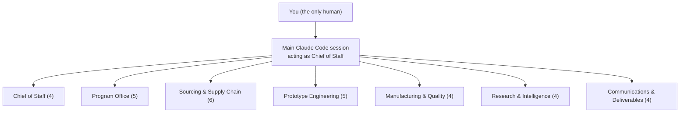

# Hardware PM Agents

> Seven departments. 32 agents. One human.

A ready-to-use set of [Claude Code](https://claude.com/claude-code) subagents for a hardware **Technical / Operations Program Manager**. It covers component sourcing, prototype builds, manufacturing readiness, and leadership reporting.

The departments follow what hardware TPM/OPM roles commonly cover: NPI schedule ownership, risk management, sourcing and cost, CM/ODM partners, production readiness, compliance, and clear reporting.

## Org chart



| Department | # | Agents |
|---|:-:|---|
| Chief of Staff | 4 | `chief-of-staff`, `intake-router`, `approval-gate`, `decision-log` |
| Program Office | 5 | `npi-schedule-keeper`, `risk-register`, `dependency-mapper`, `budget-tracker`, `gate-review-prep` |
| Sourcing & Supply Chain | 6 | `bom-cleaner`, `alt-part-finder`, `quote-comparer`, `should-cost-modeler`, `supplier-risk-watcher`, `supplier-directory` |
| Prototype Engineering | 5 | `build-tracker`, `proto-procurement`, `test-data-analyst`, `issue-triager`, `ecn-tracker` |
| Manufacturing & Quality | 4 | `cm-liaison`, `yield-analyst`, `compliance-tracker`, `readiness-checker` |
| Research & Intelligence | 4 | `industry-watchdog`, `datasheet-reader`, `teardown-researcher`, `research-librarian` |
| Communications & Deliverables | 4 | `status-report-writer`, `exec-pre-read-formatter`, `meeting-notes-agent`, `email-drafter` |

## How it works

- Each file in `.claude/agents/` is a **subagent**: a specialist with its own instructions and tool list.
- Your main Claude Code session reads `CLAUDE.md` and acts as Chief of Staff. It hands each task to the right subagent and combines the results.
- Subagents cannot start other subagents. That is why the main session does the routing, and `chief-of-staff` only writes the plan.
- **Draft, never send.** No agent sends email, places orders, or publishes. Outward actions wait in `program/approvals.md` for your yes.

## Quick start

1. Install [Claude Code](https://docs.claude.com/en/docs/claude-code/overview).
2. Clone this repo and open it:
   ```bash
   git clone https://github.com/wenwenmax/hardware-pm-agents.git
   cd hardware-pm-agents
   claude
   ```
3. Edit the **Your program** section of `CLAUDE.md` (phases, suppliers, part-number format).
4. Ask for work in plain language, for example:
   - "Clean the BOM in sourcing/boms/main-board.xlsx and find alternates for single-source parts."
   - "Compare the quotes in sourcing/quotes/enclosure/."
   - "Write this week's status report."
5. Type `/agents` in Claude Code to see or edit the agents.

Folders such as `sourcing/` and `program/` are created by the agents the first time they save something.

## Folder layout (created as you work)

```
program/          schedule, risks, budget, decisions, approvals, gates, plans
sourcing/         boms/, alternates/, quotes/, should-cost/, suppliers/, risk-alerts/
prototype/        builds/, procurement/, tests/, issues/, ecn/
manufacturing/    cm/, yield/, compliance/, readiness/
research/         digests/, datasheets/, teardowns/, index.md
deliverables/     status/, pre-reads/, meetings/, emails/
inbox/            drop new files here for intake-router
```

## Suggested build-up

| Phase | Start using | Why |
|---|---|---|
| 1 | bom-cleaner, quote-comparer, datasheet-reader | Quick wins that are easy to check |
| 2 | status-report-writer, meeting-notes-agent, decision-log | Saves hours every week |
| 3 | chief-of-staff, approval-gate, risk-register | Coordination once several agents are in use |
| 4 | supplier-risk-watcher, industry-watchdog | Run weekly on a schedule |
| 5 | Everything else | As real needs appear |

## Security

- **No network from Bash.** `.claude/settings.json` turns on the Claude Code sandbox, which blocks network access from shell commands. It also denies `curl`, `wget`, `ssh`, `scp`, `nc`, `rm`, and `git push`. Bash agents use the shell only for local Python, CSV, Excel, and charts.
- **Web access is split from the most sensitive data.** `should-cost-modeler` reads supplier quotes, so it can search but not fetch pages. Agents that use the web search with public part numbers and names only, never internal part numbers, prices, or the confidential terms you list in `CLAUDE.md`.
- **Untrusted content is data.** Emails, PDFs, and web pages can contain hidden instructions. Agents quote them and flag them instead of following them.
- **Your data stays out of git.** `.gitignore` excludes every program data folder. Use a separate private repo if you want to version your data.
- **Approvals need your own words.** `approval-gate` marks an item APPROVED only when the main session quotes your approval of that item.

These rules reduce risk; they don't remove it. Review drafts before you send anything.

## Limits

- Agents can misread PDFs and spreadsheets. Check part numbers, prices, and specs against the source before acting.
- Web data (lead times, stock, news) is a snapshot with a date, not a guarantee.
- `compliance-tracker` is for planning only, not legal advice.

## License

MIT. See [LICENSE](LICENSE).
